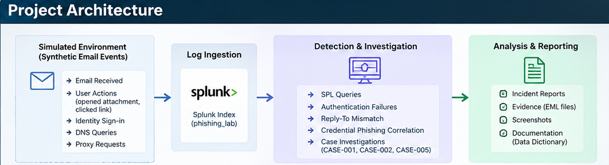

# SOC Phishing Investigation Lab

A hands-on SOC portfolio project that uses synthetic email-security telemetry in Splunk to detect, triage, investigate, correlate, and report phishing and business-email-compromise scenarios.

The lab demonstrates analyst workflows rather than only tool installation. It covers email authentication analysis, suspicious attachment triage, brand-lookalike detection, Reply-To mismatch detection, user-action correlation, suspicious sign-in correlation, and incident reporting.

> Safety note: The project uses synthetic evidence, reserved `.example` domains, and documentation IP ranges. It does not require live malware or interaction with malicious infrastructure.

## Architecture



### Data flow

1. Synthetic email and security events are generated for multiple cases.
2. Events are ingested into the Splunk index `phishing_lab`.
3. JSON fields are extracted and normalized with SPL.
4. Detection queries identify suspicious authentication, attachment, brand, and Reply-To indicators.
5. Correlation queries join user actions with identity activity.
6. Analysts document case findings, IOCs, severity, and recommended containment.
7. A formal incident report is produced for the highest-impact credential-phishing scenario.

## Key investigated cases

| Case | Scenario | Key findings | Disposition |
|---|---|---|---|
| CASE-001 | Suspicious payroll attachment | SPF failed, DKIM absent, DMARC failed, macro-enabled `.docm` attachment, message delivered, user opened attachment, local threat intelligence marked sender/attachment malicious | Malicious phishing - attachment delivery and interaction confirmed in the synthetic lab |
| CASE-002 | Credential-phishing link and account impact | Microsoft 365 brand lookalike, malicious-looking login URL, message delivered, link clicked at 10:06:30 UTC, suspicious successful sign-in at 10:10:40 UTC, 250-second gap, source IP `203.0.113.200` | High-confidence credential-phishing incident with suspected account compromise |
| CASE-005 | Executive impersonation / BEC | SPF, DKIM, and DMARC passed, but Reply-To domain differed from sender domain and the subject used urgency while impersonating the CEO | Suspicious BEC / executive-impersonation attempt |

CASE-003 and CASE-004 are retained as benign-baseline cases. CASE-006 demonstrates a malicious attachment scenario that was successfully blocked by the gateway.

## Repository structure

```text
SOC-Phishing-Investigation-Lab/
|-- README.md
|-- architecture/
|   `-- architecture.png
|-- evidence/
|   `-- README.md
|-- detections/
|   |-- auth-failure.md
|   |-- reply-to-mismatch.md
|   `-- credential-phish-correlation.md
|-- investigations/
|   |-- CASE-001.md
|   |-- CASE-002.md
|   `-- CASE-005.md
|-- splunk/
|   `-- spl_queries.txt
|-- reports/
|   `-- CASE-002-incident-report.pdf
|-- screenshots/
|   `-- README.md
`-- docs/
    |-- data-dictionary.md
    `-- lab-notes-source.txt
```

## Splunk prerequisites

- Access to Splunk Enterprise, Splunk Cloud, or Splunk Free/Trial with search capability.
- A Splunk index named `phishing_lab`, or update the queries to your own index name.
- Synthetic JSON telemetry loaded into the index.
- Search time range set to all time, or use `earliest=0` in the SPL.

## Important field-normalization note

During this lab, some JSON fields appeared twice because Splunk automatic JSON extraction and `spath` could both expose the same values. Where this could affect string operations, the queries normalize fields with `mvindex(field,0)` before parsing or comparison.

Example:

```spl
| eval sender_clean=mvindex(sender,0)
| eval reply_clean=mvindex(reply_to,0)
```

## Detection coverage

### 1. Email authentication failures
Detects email events with suspicious SPF, DKIM, or DMARC results. This identified CASE-001 and CASE-006.

### 2. Reply-To domain mismatch
Compares the sender domain with the Reply-To domain. This identified CASE-005 even though SPF, DKIM, and DMARC passed.

### 3. Credential-phishing correlation
Correlates a user link click with a subsequent successful sign-in where MFA was not satisfied. CASE-002 produced a 250-second interval between click and suspicious sign-in.

## Skills demonstrated

- Splunk SPL search and field extraction
- Email-header and authentication analysis
- SPF, DKIM, and DMARC triage
- IOC extraction and enrichment workflow
- Phishing and BEC detection logic
- Temporal event correlation
- Identity sign-in investigation
- False-positive-aware triage
- MITRE ATT&CK mapping
- SOC incident documentation and reporting

## Portfolio evidence to capture

Add your own Splunk screenshots to `screenshots/` for:

- Email inventory search
- Authentication-failure detection
- CASE-001 suspicious attachment results
- CASE-002 brand-lookalike result
- CASE-002 click-to-sign-in correlation
- CASE-005 Reply-To mismatch
- Risk-scoring table

Do not fabricate screenshots. Capture them from your own Splunk environment after running the supplied queries.

## Recommended interview explanation

"I built a synthetic phishing-investigation lab in Splunk and treated the cases as SOC tickets. I created detections for authentication failures and Reply-To mismatches, investigated a malicious attachment case, correlated a credential-phishing click with suspicious sign-in activity 250 seconds later, and produced an incident report with containment and remediation recommendations. I also kept benign cases to avoid treating every unusual email as malicious."
